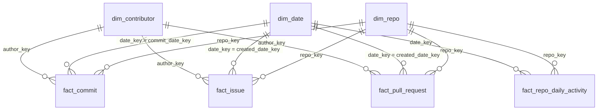

# GitHub Open-Source Project Health Analytics

Course: Data Analysis and Visualization (DAV), FAST-NUCES Lahore
Team: Hamza Sheikh (24L-2500), Sadeem Arshad (24L-2502)

A Spark/Databricks pipeline using the Medallion Architecture (Bronze, Silver,
Gold), ending in a Power BI dashboard.

## Business question
Which open-source Python projects are healthy and active, who contributes to
them, and how fast are issues and pull requests handled?

## Data source
GitHub REST API, for 8 repos: pandas-dev/pandas, numpy/numpy,
scikit-learn/scikit-learn, matplotlib/matplotlib, scipy/scipy,
fastapi/fastapi, pallets/flask, pytest-dev/pytest.

We pull 3 entities per repo: commits, issues, pull requests. Note: GitHub's
issues endpoint also returns pull requests, so these get split apart in
Silver.

## Sample data (Phase 1)
| Sample | Rows | Size |
|---|---|---|
| data/samples/full/ | 4,800 | 45.18 MB |
| data/samples/incremental/ (since 2026-09-19) | 2,426 | 29.70 MB |

## Repo contents
```
data/samples/full/          sample full-load JSON (Phase 1)
data/samples/incremental/    sample incremental JSON (Phase 1)
extract_github.py            Phase 1 extraction script
pii_scan.py                  checks samples for PII
docs/                        proposal doc (Phase 1)
databricks/
  00_setup_and_logging.py    makes the catalog/schema/tables, has shared helper functions
  01_raw_to_bronze.py        GitHub API -> Bronze (full / incremental / backfill)
  02_bronze_to_silver.py     Bronze -> Silver (typed, deduped, PII hashed)
  03_schema_drift_demo.py    shows the pipeline doesn't break on a weird/broken record
  04_silver_to_gold.py       Silver -> Gold star schema (Phase 3)
  05_run_pipeline.py         runs 01 -> 02 -> 04 in one go (Phase 3)
docs/                        also holds the Phase 3 report (PDF) and the Power BI file
```

## How the pipeline works
GitHub API -> Bronze (raw JSON as-is) -> Silver (typed, cleaned, PII hashed) ->
Gold (star schema) -> Power BI dashboard.

Every write to Bronze and Silver uses MERGE INTO, keyed on the commit sha or
the issue/PR id. So running a notebook again doesn't create duplicate rows,
it just adds new stuff and updates anything that changed on GitHub. Every run
writes a row to `pipeline_execution_logs`, pass or fail, so there's always a
record of what happened.

## Bronze tables
`bronze_commits`, `bronze_issues`, `bronze_pulls` all have the same columns:

| Column | Type | What it is |
|---|---|---|
| record_key | string | sha for commits, id for issues/pulls. This is the MERGE key |
| source_repo | string | e.g. pandas-dev/pandas |
| entity_type | string | commits / issues / pulls |
| raw_json | string | the raw GitHub response for this record, kept as text |
| api_params | string | which params we used to fetch it |
| load_type | string | full / incremental / backfill |
| batch_id | string | which run wrote this row |
| run_id | string | id of that notebook run |
| load_timestamp | timestamp | when it was written |

`bronze_quarantine`: records with no usable key (e.g. missing sha) -
source_repo, entity_type, raw_record, reason, batch_id, run_id, load_timestamp.

## Silver tables
Author names/emails are gone here, replaced with a hashed `author_key`.

`silver_commit`: sha (key), repo, author_key, committer_key, committed_at,
message_length, is_merge_commit, load_timestamp.

`silver_issue`: issue_id (key), repo, number, state, author_key, created_at,
updated_at, closed_at, comment_count, time_to_close_hours, load_timestamp.

`silver_pull_request`: pr_id (key), repo, number, state, author_key,
created_at, updated_at, closed_at, merged_at, is_merged, is_draft,
base_branch, time_to_merge_hours, load_timestamp.

`silver_quarantine`: records that failed to parse - entity_type, record_key,
repo, reason, raw_json, batch_id, run_id, load_timestamp.

`pipeline_execution_logs`: one row per run per entity - run_id, layer,
entity, parameters, start_time, end_time, status, rows_inserted,
rows_updated, rows_quarantined, error_message, rows_aggregated,
duration_seconds. This is the proof table. (The last two columns were added
in Phase 3 for the Silver-to-Gold step.)

## Gold layer (Phase 3)
A star schema: small "dimension" tables describe things (repo, day, person),
and "fact" tables hold the events (commits, issues, pull requests). Each fact
row points at the dimensions by key.



Data dictionary (PK = primary key, FK = foreign key):

| Table | Columns |
|---|---|
| `dim_repo` | **repo_key (PK)**, repo_full_name, owner, repo_name |
| `dim_date` | **date_key (PK, yyyymmdd)**, full_date, year, quarter, month, month_name, year_month, day_of_month, day_of_week, day_name, week_of_year, is_weekend |
| `dim_contributor` | **author_key (PK, hashed)**, first_seen_at. Has one extra row, `unknown`, for missing authors |
| `fact_commit` | **sha (PK)**, repo_key (FK), author_key (FK), committer_key, commit_date_key (FK), committed_at, message_length, is_merge_commit, load_timestamp |
| `fact_issue` | **issue_id (PK)**, repo_key (FK), author_key (FK), created_date_key (FK), closed_date_key (FK, can be empty), issue_number, state, is_closed, comment_count, time_to_close_hours, created_at, closed_at, load_timestamp |
| `fact_pull_request` | **pr_id (PK)**, repo_key (FK), author_key (FK), created_date_key (FK), closed_date_key (FK), merged_date_key (FK), pr_number, state, is_merged, is_draft, base_branch, time_to_merge_hours, created_at, closed_at, merged_at, load_timestamp |
| `fact_repo_daily_activity` | **repo_key + date_key (PK)**, commits, merge_commits, active_contributors, issues_opened, issues_closed, prs_opened, prs_merged, updated_at |

`repo_key` is `xxhash64(repo)`. `date_key` is the day as a number, like
20261024. The primary and foreign keys are also written into Unity Catalog
as informational constraints (Databricks stores them but doesn't enforce
them). Uniqueness is really kept by the MERGE keys.

Two views feed the audit part of the dashboard:
`vw_audit_pipeline_runs` (the log table) and `vw_audit_quarantine` (counts of
bad records per layer and reason, with no raw data in it).

The fact tables use Liquid Clustering (`CLUSTER BY repo_key and the date key`), and
`04_silver_to_gold` runs `OPTIMIZE` at the end.

Each Gold table is filled with `MERGE INTO`. Facts only read Silver rows
loaded since the pipeline started. `fact_repo_daily_activity` is rebuilt from
the fact tables each time. Every table logs a row in `pipeline_execution_logs`
with `layer = Silver-to-Gold`, `rows_aggregated` and `duration_seconds`.

## How to run it
Import all the notebooks from `databricks/` into Databricks, same folder.

**Everything at once (use this):** run `05_run_pipeline`. It runs 01, then 02,
then 04 (Gold), so Gold refreshes every time new data reaches Silver. Widgets:
- `load_type` = incremental (last 24 hours, the normal daily run), full
  (about 12 months, cut into `chunk_days` day pieces), or backfill
  (give `since_date` and `until_date`).
- `run_gold` = yes/no.
- `github_token`: paste it for the run, then clear it.
If a window fails, the notebook says which one, and you run just that one again.

**One step at a time:**
1. `00_setup_and_logging` - run once, makes everything
2. `01_raw_to_bronze` - pulls from GitHub into Bronze
3. `02_bronze_to_silver` - Bronze into Silver
4. `04_silver_to_gold` - Silver into Gold (leave `silver_since` blank to rebuild from all of Silver)
5. `03_schema_drift_demo` - optional proof, safe to re-run anytime

**Normal run (incremental):** on `01_raw_to_bronze`, set `load_type` =
incremental, leave `since_date`, `until_date`, `batch_id` blank. Then run
`02_bronze_to_silver` with `batch_id` blank too.

**First time ever (full load):** same but `load_type` = full. Blank
`since_date` pulls about the last 12 months.

**Backfill (redo an old date range on purpose):** set `load_type` = backfill,
`since_date` and `until_date` to whatever window you need
(e.g. 2026-09-01T00:00:00Z to 2026-09-08T00:00:00Z), and give `batch_id` a
name so you can find it later. Nothing is hardcoded, it all comes from the
widgets. Re-running a backfill over the same window doesn't duplicate rows.

**GitHub token:** paste it into the `github_token` widget each session. Never
saved anywhere. Works without one too, just with a lower rate limit.

**Checking the proof:** query
`SELECT * FROM workspace.dav_project.pipeline_execution_logs ORDER BY start_time DESC;`
Run 01 or 02 twice with the same inputs - the second run's `rows_inserted`
should be 0 (or close to it), since the data's already there.

## PII handling
Raw names/emails only ever sit inside Bronze's raw_json. Silver drops them
completely and replaces them with a salted SHA-256 hash (`author_key`). The
salt is just a fixed string in the code, not a real secret (repo's public
anyway) - it's there so the same person always hashes the same way, which is
needed for MERGE to recognize repeat authors.

## Schema drift
`03_schema_drift_demo.py` shows what happens with a weird record:
- an unexpected new field -> ignored, doesn't break anything
- a field in the wrong shape -> that one field goes blank, row still works
- a genuinely broken record -> goes to silver_quarantine with a reason,
  doesn't stop the run
- adding a new column to Silver on purpose later -> done with
  `MERGE WITH SCHEMA EVOLUTION INTO`, no rebuilding tables

## Status
- [x] Phase 1: proposal, sample data, extraction scripts
- [x] Phase 2: Bronze + Silver pipeline, MERGE INTO, backfill, schema drift,
      logging, this README (due 10 Oct 2026)
- [x] Phase 3: Gold star schema, automatic Gold refresh, Silver-to-Gold logging
- [ ] Phase 3: Power BI dashboard + final report PDF (due 24 Oct 2026)
